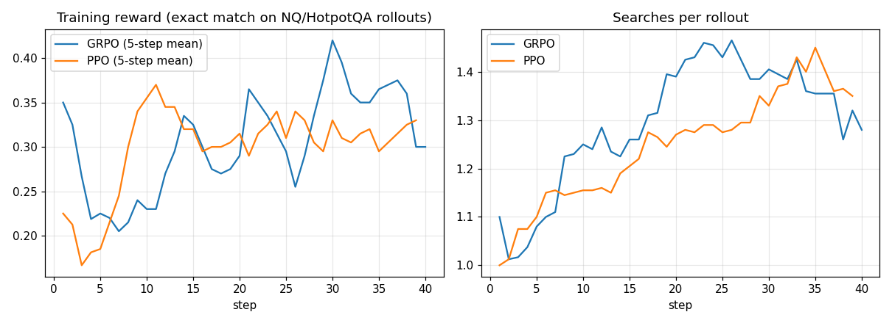

# Search-R1 with LoRA on Bamboogle — INFO 7375 Assignment 8

**Course:** INFO 7375, Self-Improving AI · Week 08 · **Authors:** Ritvij Naram and Ghouse

The assignment: understand and replicate the class starter
[`suhabe/tiny-zero-lora`](https://github.com/suhabe/tiny-zero-lora), then replicate the
Qwen2.5-3B-Instruct rows of Search-R1 ([Jin et al., arXiv:2503.09516v5](https://arxiv.org/abs/2503.09516))
on Bamboogle: Direct Inference, and Search-R1-instruct trained with both PPO and GRPO, using
LoRA (PEFT) instead of full fine-tuning.

## Results (Bamboogle, 125 questions, exact match)

| Method | Model | Ours | Paper | Paper source |
|---|---|---:|---:|---|
| Direct Inference | Qwen2.5-3B-Instruct, no retrieval | **0.024** (3/125) | 0.024 | Table 2 |
| Search-R1-instruct, GRPO (released v0.2 checkpoint) | `PeterJinGo/SearchR1-nq_hotpotqa_train-qwen2.5-3b-it-em-grpo-v0.2` | **0.272** (34/125) | 0.232 | Table 3 |
| Search-R1-instruct, PPO (released v0.2 checkpoint) | `PeterJinGo/SearchR1-nq_hotpotqa_train-qwen2.5-3b-it-em-ppo-v0.2` | **0.336** (42/125) | 0.264 | Table 2 |
| Search prompt + E5, untrained (our baseline for the LoRA runs) | Qwen2.5-3B-Instruct, no RL | 0.120 (15/125) | — | — |
| Search-R1-instruct, GRPO (our LoRA run, 40 steps) | Qwen2.5-3B-Instruct + rank-16 LoRA | **0.240** (30/125) | 0.232 | Table 3 |
| Search-R1-instruct, PPO (our LoRA run, 39 steps) | Qwen2.5-3B-Instruct + rank-16 LoRA actor and critic | **0.192** (24/125) | 0.264 | Table 2 |

All rows use the same 125 FlashRAG Bamboogle questions, normalized exact match (lowercase, strip
punctuation and articles, collapse whitespace, any accepted alias), greedy decoding, and for the
search rows the same E5 retriever over Wikipedia-2018 with top-3 passages, up to 4 searches and
then one final turn without search.

**Evaluation details.**
- **Scoring:** every "Ours" number is computed by `scripts/evaluate.py` from the run's saved
  `predictions.jsonl` against the FlashRAG gold labels. The SHA-256 of the predictions file is
  recorded in `metrics.json`. `results/paper_reference.json` only supplies the "Paper" column.
- **Decoding is greedy everywhere** (`do_sample=False`, so Qwen's default temperature, top-p and
  top-k are inactive), on Qwen2.5-3B-Instruct revision `aa8e725`.
- **Direct Inference:** system and user message through the chat template, at most **32 new
  tokens**, stopping at end-of-sequence. The whole output is the answer.
- **Search rows:** up to **500 new tokens per turn**, each turn stopped at its first `</search>`
  or `</answer>`; up to **4 search turns plus one final turn**, within a 4,096-token context.
  The answer is the last `<answer>` tag in the model's response.

- **Direct Inference matches the paper exactly (0.024).** It uses FlashRAG's no-retrieval
  prompt with greedy decoding and a 32-token answer.
- **Our LoRA runs: GRPO reaches the paper's GRPO number (0.240 vs 0.232); PPO does not (0.192 vs
  0.264).** Both adapters were trained for only ~40 steps (about 1,600 rollouts, under 1% of the
  paper's rollouts) with LoRA instead of full fine-tuning, so they should be read against the
  untrained search baseline (0.120): **short GRPO training doubles it (+15 questions) and PPO adds
  +9 questions.** The untrained model also leaves 20 questions unanswered within the turn budget,
  against 1 for GRPO and 0 for PPO, so much of the gain is learning to finish with an `<answer>` tag. PPO learns more
  slowly early in training because its critic starts from zero (the paper makes the same
  observation: GRPO converges faster, PPO is slower but more stable, Fig. 2a), and 39 steps is
  well inside that early phase. With one seed and 125 questions, ±1 question is ±0.008 EM.
- **The released checkpoints score above the paper** (GRPO +0.040, PPO +0.072); the paper's
  ordering, PPO above GRPO, holds. One question is worth 0.008 here, so these gaps are 5 and 9
  questions. Possible reasons: the paper evaluates through veRL's batched vLLM pipeline, while we
  use Hugging Face generation in bf16 with our own turn loop (small numerical and tokenization
  differences change greedy paths); our scorer reads only the model's response; and the
  released v0.2 files may not be the exact step the paper reported. These numbers are therefore
  a faithful re-evaluation of the released models, not a bit-exact reproduction of the table.

## What was run

| Stage | Where | Result |
|---|---|---|
| Starter walkthrough (`walkthrough.py`, tokenizer + rewards) | Local CPU | Prompts and all 7 reward scenarios behave as documented |
| Starter's own `train.py`, 20 steps, memory-reduced | Modal A100-80GB | Trained; held-out format 33.0% → 76.5%, solve rate 5.5% → 4.0%. See [the starter section](#tiny-zero-lora-replication). |
| E5 index, corpus and encoder download (64.6 GB + 14.4 GB) | Modal CPU | Done; corpus repaired (see below) |
| Direct Inference, 125 questions | Modal L4 | EM 0.024 |
| Released v0.2 GRPO and PPO, 125 questions with search | Modal L40S + co-located E5 | EM 0.272 and 0.336 |
| Our LoRA GRPO training, 40 steps × 40 rollouts | Modal L40S + co-located E5 | 1,600 rollouts in 103 min; training reward 0.225 → 0.300 (first/last 5 steps) |
| Our LoRA PPO training, 39 steps × 40 rollouts | Modal L40S + co-located E5 | 1,560 rollouts in 102 min; training reward 0.185 → 0.330 |
| Our GRPO and PPO adapters, 125 questions with search | Modal L40S + co-located E5 | EM 0.240 and 0.192 |
| Untrained instruct model with the same search prompt | Modal L40S + co-located E5 | EM 0.120 (20 questions unanswered within the turn budget) |

## Method

**Paper parity.** The search prompt, turn logic and invalid-action handling follow upstream
Search-R1 v0.2 line by line ([docs/PAPER_PARITY.md](docs/PAPER_PARITY.md) cites the file and line
for each):

- **Prompt:** the verbatim training template ("Answer the given question. You must conduct
  reasoning inside <think> and </think> first every time you get new information. ... For example,
  <answer> Beijing </answer>. Question: …?").
- **Turns:** up to 4 action turns of up to 500 tokens each. Each turn's first `<search>` or
  `<answer>` tag decides the action; then one final turn with search disabled.
- **Invalid actions:** a turn with no valid action gets upstream's "My previous action is
  invalid…" message and a retry.
- **Loss masking:** retrieved passages and environment messages stay in context but are
  excluded from the policy loss.
- **Reward:** exact match of the last `<answer>` tag only (no format reward), as upstream.

**Retrieval.** E5 (`intfloat/e5-base-v2`) dense retrieval over the 21,015,324-passage
Wikipedia-2018 corpus with the upstream flat FAISS index (`PeterJinGo/wiki-18-e5-index`), top-3.
The retriever runs inside the GPU container (`--retrieval-url local`), so it needs about 96 GiB of
RAM for the index but no separate server. `wiki-18.jsonl.gz` turned out to be a gzipped tar
archive, whose header and padding would have corrupted the first and last passages; the corpus
was repaired and re-verified (21,015,324 rows).

**Training (our LoRA runs).**
- **Model:** frozen Qwen2.5-3B-Instruct with a rank-16, alpha-32 LoRA adapter on all seven
  projections, the starter's LoRA configuration. PPO adds a separate critic LoRA adapter and a
  value head; the reference policy is the base model with adapters disabled.
- **GRPO:** 8 prompts × 5 samples per step, group-normalized advantages, clipped ratio, and a
  `low_var_kl` loss with β = 0.001.
- **PPO:** 40 prompts per step, GAE with λ = γ = 1, KL reward shaping with β = 0.001, and value
  clip 0.5.
- **Both:** two minibatch optimizer steps per batch (so clipping is active), AdamW at lr 2e-5
  (actor) and 1e-4 (critic), sampling at temperature 1 and top-p 1.
- **Generation:** batched across all rollouts of a step.



Training reward is noisy at 40 rollouts per step, but both runs trend upward, and **searches per
rollout rise steadily from about 1.0 to 1.3–1.45**. That is the same behaviour as the paper's
Figure 2(d) ("the LLM learns to call search more"), at a far smaller scale.

## Search traces (released PPO checkpoint)

**Correct, two searches** (`bamboogle_0001`, gold: James Madison):

```text
<think>To answer this question, I need to first determine the year Citibank was founded. ...
<search>When was Citibank founded?</search>
  [information: Doc 1 (Citigroup) … Doc 2/3 …]
<think>From the information provided, Citibank was founded in 1812. Now, we need to find out
who was the president of the United States in 1812.
<search>Who was president of the United States in 1812?</search>
  [information: Doc 1 (1812 United States elections) …]
<think>From the information provided, in 1812, James Madison was the President ...</think>
<answer>James Madison</answer>
```

**Wrong, two searches** (`bamboogle_0006`, "When did the president who set the precedent of a
two term limit enter office?", gold: April 30, 1789):

```text
<search>president two-term limit precedent</search>
  [information: Doc 1 (Twenty-second Amendment to the United States Constitution) …]
<think>... it seems Franklin D. Roosevelt became the first president to set the precedent of a
two-term limit. Now, I need to find out when he entered office.
<search>Franklin D. Roosevelt inauguration date</search>
  [information: Doc 1 (First inauguration of Franklin D. Roosevelt) …]
<answer>March 4, 1933</answer>
```

Full traces are in [results/traces/](results/traces/).

## Failure analysis (released checkpoints)

| | Released PPO | Released GRPO |
|---|---:|---:|
| Correct | 42 | 34 |
| Wrong answer after searching | 63 | 80 |
| Near miss (gold and answer contain each other) | 12 | 9 |
| No answer within 4 searches + final turn | 8 | 2 |
| Answered without any search | 0 | 0 |
| Mean searches per question | 2.19 | 2.23 |

- **Wrong bridge entity (most common).** Bamboogle questions are two-hop. When the first search
  returns a related but different entity, the model commits to it and answers the second hop
  correctly for the wrong entity. The two-term-limit question above is typical: the Twenty-second
  Amendment passage leads it to Franklin D. Roosevelt instead of George Washington.
- **Near misses under strict exact match.** Twelve PPO answers differ only in granularity,
  for example "Lockheed" for "Lockheed Corporation", "May 27, 1827" for "1827", and "1891" for
  "January 8, 1891". These count as wrong under EM, as in the paper.
- **Search loops.** PPO more often keeps searching until the turn budget runs out (8
  questions), while GRPO answers earlier (2), which partly offsets its lower accuracy.
- **Retrieval misses.** For several questions the needed fact is not in the top-3 passages, so
  the model guesses after searching (e.g. the Voyager launch-vehicle question).

## tiny-zero-lora replication

**What the starter does.**
- **Task:** Countdown arithmetic, from `Jiayi-Pan/Countdown-Tasks-3to4` (2,000 examples, a 90/10
  split). Reach the target number using each given number exactly once.
- **Model and prompt:** Qwen2.5-3B-Instruct in bf16, with a chat prompt whose assistant turn is
  pre-filled with "Let me solve this step by step.\n<think>".
- **LoRA:** rank 16, alpha 32, dropout 0.05, on q/k/v/o/gate/up/down.
- **GRPO:** TRL's `GRPOTrainer` with 16 generations per prompt, lr 2e-5 (linear decay), β =
  0.001, temperature 1.0, up to 1,024 completion tokens and vLLM generating on the same GPU.
- **Rewards:** a strict format reward plus an equation reward (each number used once,
  evaluated safely, within 1e-5 of the target).

**How this project carries it over.**
- **Kept:** the same base model, the same LoRA rank, alpha and target modules, KL β = 0.001,
  lr 2e-5, temperature 1.0, and the group-normalized advantages with a clipped objective.
- **Changed:** LoRA dropout is 0 instead of 0.05, so old and new log-probabilities can be
  compared exactly; TRL's trainer is replaced by an explicit PyTorch loop, which supports
  multi-turn retrieval with masked observations and a PPO critic; and the reward is answer exact
  match, as in Search-R1.

**Replication runs.**
- **Local walkthrough** (pinned commit `3659acf`, its own pinned environment): both prompts
  render through the Qwen chat template, and all seven reward scenarios score as their labels
  say (correct format and equation 1/1; wrong result 1/0; missing think block 0/1; unused
  number 1/0; duplicate inputs 1/1; division by zero 1/0; missing tags 0/0).
- **Modal runs of its own `train.py`** (A100-80GB):
  - *Full settings:* the first attempt crash-looped before training because of a bug in our
    launcher (an import-time path check that only holds locally), fixed with `modal.is_local()`.
    The second attempt ran the step-0 held-out evaluation (solve rate 5.5%, format 32.0%), then
    the first training step ran **out of GPU memory** (79.2 GiB in use). The starter is sized for
    the B300 (288 GB) in its own `modal_train.py`: 16 generations of 1,024 tokens, a training
    batch of 16, no gradient checkpointing, and vLLM reserving 30% of the GPU.
  - *Scaled-down replication (completed):* the same `train.py` with only three settings reduced to
    fit 80 GB: `per_device_train_batch_size` 16 → 8, `num_generations` 16 → 8 and
    `max_completion_length` 1,024 → 512. The LoRA configuration, learning rate, β, rewards,
    dataset, vLLM colocation and evaluation schedule are unchanged, and the run is 20 steps
    (`scripts/run_starter.py --reduced`). Training took 258 s.

    | Held-out evaluation | Step 0 | Step 10 | Step 20 |
    |---|---:|---:|---:|
    | Solve rate (equation reward) | 5.5% | 4.0% | 4.0% |
    | Format reward | 33.0% | 59.0% | 76.5% |

    This is the starter's characteristic early phase: the model first learns the required
    `<think>…</think>
<answer>…</answer>` format (33% → 76.5%), while arithmetic accuracy only
    improves over many more of the starter's 2,000 steps. Twenty steps reproduce the format
    learning, not the later "aha" gains in solve rate.

## Training scale vs the paper

| | Paper (Search-R1, App. B.2) | Ours |
|---|---|---|
| Fine-tuning | Full model (actor, and a full critic for PPO) | Rank-16 LoRA (actor; plus critic LoRA and value head for PPO) |
| Hardware | 8 × H100 | 1 × L40S |
| Prompts per step | 512 | GRPO 8 (×5 samples = 40 rollouts); PPO 40 |
| Training steps | 500 (paper text; v0.2 scripts use 1,005) | GRPO 40, PPO 39 (100-minute wall-clock budget each) |
| Rollouts in total | GRPO ≈ 1.28M, PPO ≈ 256k | GRPO 1,600 (0.13% of the paper), PPO 1,560 (0.6%) |
| Trainable parameters | All ~3.1B (plus a full critic for PPO) | Actor LoRA 29.9M (~1%); PPO critic LoRA + value head 29.9M |
| Learning rate | 1e-6 actor / 1e-5 critic, with warm-up | 2e-5 actor / 1e-4 critic (LoRA), no warm-up |
| Training data | Full NQ + HotpotQA train merge (~170k) | 4,000-question frozen subset |

## Cost (Modal, shared class workspace)

| Stage | GPU | Approx. cost |
|---|---|---|
| Retrieval assets download and corpus repair | CPU | $0.06 |
| Data preparation | CPU | $0.01 |
| Direct Inference | L4 | $0.16 |
| Released GRPO + PPO evaluation (incl. one failed launch) | L40S + 96 GiB RAM | ≈ $2.40 |
| Starter 20-step runs (crash-loop, OOM, scaled-down success) | A100-80GB | ≈ $1.30 |
| LoRA GRPO + PPO training (6,217 s + 6,126 s) | L40S + 96 GiB RAM | ≈ $10.60 |
| Our two adapters' evaluation (384 s + 450 s, incl. one launch with a wrong checkpoint path) | L40S + 96 GiB RAM | ≈ $0.85 |
| Untrained-with-search baseline evaluation (357 s) | L40S + 96 GiB RAM | ≈ $0.31 |
| **Total** | | **≈ $15.70** |
| Retrieval volume storage (~74 GiB at $0.09/GiB-month) | — | ≈ $0.22/day |

Costs are computed from Modal's published rates (`modal billing rates`) and measured container
time.

## Reproduce

```bash
python -m venv .venv && .venv/Scripts/python -m pip install -r requirements.txt   # plus CPU torch for tests
python -m unittest discover -s tests                                             # 78 CPU tests
modal run --detach modal_retrieval.py                       # E5 index, corpus, encoder -> volume
modal run modal_retrieval.py --job index                    # corpus offsets
modal run modal_app.py --job prepare                        # Bamboogle + training subset + revision lock
MODAL_GPU=L4 modal run modal_app.py --job evaluate --method direct --run-name direct-v1 --acknowledge-compute
MODAL_GPU=L40S MODAL_MEMORY=98304 modal run modal_app.py --job evaluate --method released_ppo \
    --run-name released-ppo-v02b --retrieval-url local --acknowledge-compute
MODAL_GPU=L40S MODAL_MEMORY=98304 modal run --detach modal_app.py --job train --algorithm grpo \
    --profile short --run-name grpo-short --retrieval-url local --minutes 100 --acknowledge-compute
python scripts/summarize_results.py --runs downloaded-runs  # after: modal volume get ... /runs
```

## Repository layout

```text
search_r1_team/     model (frozen Qwen + LoRA actor/critic), GRPO/PPO objectives, multi-turn rollout, retrieval client
scripts/            data prep, training, inference, scoring, retrieval server/downloader, results summary
configs/            smoke, short and experiment configurations
modal_app.py        Modal runner: data prep, training, evaluation, co-located E5 retriever
modal_retrieval.py  CPU jobs: stream the E5 assets to a volume, build corpus offsets
modal_starter.py    separate environment for the class starter's own train.py
docs/               paper parity (with upstream citations), setup, protocol
results/            summary.json, training curves, selected traces
tests/              CPU unit tests (synthetic fixtures)
```
