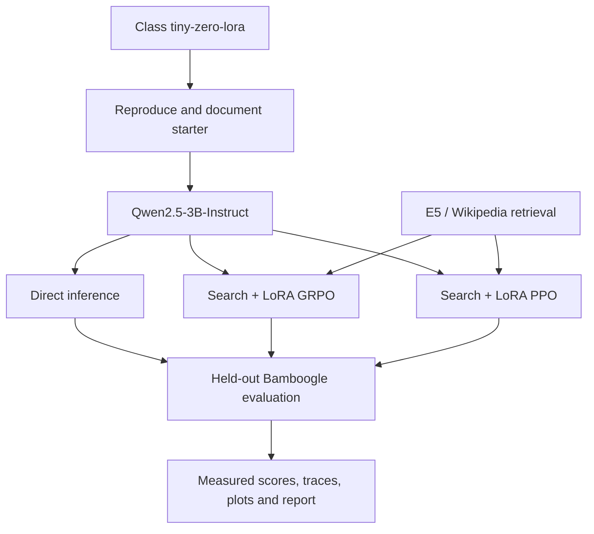

# NEU Self-Improvising — Assignment 8
## Search-R1 with LoRA · Ritvij × Ghouse

**Course:** INFO 7375, Self-Improving AI · Week 08  
**Repository:** `naramritvij/-neu-self-improvising-assignment-8`  
**Planned work split:** Ritvij 50% / Ghouse 50% — [team plan](TEAM_PLAN.md).

> **Implementation prepared; experiments not completed.** The local CPU suite
> passes 67 tests. Qwen-3B GPU integration, the class-starter reproduction,
> training and Bamboogle evaluation have not run. There are no measured model
> scores or result graphs yet. See [VALIDATION.md](VALIDATION.md).

## Start here

Read [START_HERE.md](START_HERE.md). Do not create another repository or upload
an older ZIP. Invite Ghouse to this private repository and verify the professor's
shared Modal workspace before launching any cloud jobs. The leading hyphen in
this repository's name matches the repository Ritvij created.

## Assignment scope

The supplied assignment asks for the class `tiny-zero-lora` starting point,
Qwen2.5-3B-Instruct, Bamboogle, Direct Inference and Search-R1-Instruct comparisons,
both GRPO and PPO, and PEFT rather than full fine-tuning. Its Part 1 wording says
“inference-only”; clarify whether released-checkpoint inference, new LoRA training,
or both are required before committing substantial compute. Two-person approval
and the exact deadline also remain unconfirmed. See [scope](docs/ASSIGNMENT_SCOPE.md).

## Architecture



Retrieved passages remain in context but are not treated as model-generated
policy actions. Labels are separated from inference questions. Our LoRA runs
and evaluations of released checkpoints are distinct experiment tracks.

## Included implementation

| Component | Prepared | Execution evidence |
|---|---|---|
| Class starter | Exact-commit fetcher, isolated runner and persistent Modal output | Reproduction pending |
| Direct baseline | Original Qwen instruct model; response-only predictions | GPU run pending |
| Search | Bounded multi-turn retrieval with action masks and traces | Synthetic CPU tests |
| GRPO | Group-normalized rewards, clipped actor update and reference KL | Synthetic adapter-update tests |
| PPO | Separate critic LoRA/value head, GAE and clipped updates | Synthetic actor/critic tests |
| Retrieval | Wikipedia-2018/E5 asset preparation and FAISS HTTP service | Full-index integration pending |
| Data | NQ/HotpotQA train/validation split; Bamboogle exclusion; revision locking | Synthetic split tests |
| Evaluation | Normalized exact match, coverage and prediction-hash checks | CPU tests |
| Reporting | Comparison table and plots from completed run files only | No real model results yet |
| Collaboration | 50/50 task plan, contribution log and CPU-only CI | Cloud execution is never automatic |

This is a compact educational PyTorch/PEFT adaptation, not identical veRL training
or a demonstrated reproduction of the paper's numbers. See [paper parity and
deviations](docs/PAPER_PARITY.md).

## Local checks

```bash
git clone https://github.com/naramritvij/-neu-self-improvising-assignment-8.git assignment-8
cd assignment-8
python scripts/preflight.py
```

After installing a suitable CPU PyTorch build:

```bash
python -m unittest discover -s tests -v
python -m compileall -q search_r1_team scripts tests modal_app.py modal_starter.py
```

These checks do not download Qwen or start training. The compact implementation
and the class starter use separate dependency environments. Neither GPU image
has been built or executed here. Do not mix their pinned dependencies.

## Team ownership

**Ritvij:** GRPO, direct baseline, data/evaluation and report integration.  
**Ghouse:** PPO, retrieval, search traces and failure analysis.

Both study the starter and review the other track. The work plan balances 50
estimated effort points each, not commit counts. This initialization is
AI-assisted; it is not a claim that either teammate independently wrote or ran
all the code. Record actual work in [CONTRIBUTIONS.md](docs/CONTRIBUTIONS.md).

## Execution order

1. Confirm team/scope, shared Modal membership and budget. Invite Ghouse.
2. Fetch and reproduce the class starter in its isolated environment.
3. Freeze data/model revisions, connect the retriever and run tiny GPU smoke checks.
4. Run the approved experiments. The 500-step profiles are proposals, not a verified minimum.
5. Freeze checkpoints, evaluate all held-out questions and generate the comparison.

See [Modal setup](docs/MODAL_SETUP.md), [retrieval setup](docs/RETRIEVAL_SETUP.md)
and [experiment protocol](docs/EXPERIMENT_PROTOCOL.md). No Modal job starts on push.

## Results

[Current report](results/REPORT.md) — **not submission-ready**.

| Experiment | Our exact-match score | Status |
|---|---:|---|
| Direct inference | — | Not run |
| Own LoRA + GRPO | — | Not run |
| Own LoRA + PPO | — | Not run |
| Released GRPO checkpoint | — | Not run |
| Released PPO checkpoint | — | Not run |

Published references are stored separately in
[paper_reference.json](results/paper_reference.json). They are not our results.
After real evaluation folders are under `runs/evaluation/`:

```bash
python scripts/build_report.py --runs-root runs/evaluation --grpo-training runs/grpo-main --ppo-training runs/ppo-main
```

The report rejects incomplete evaluation sets and smoke-only adapters. No example
score or synthetic chart is included as assignment evidence.

## Repository layout

```text
configs/          smoke, experiment and evaluation configurations
search_r1_team/   model, algorithms, rollout, retrieval, corpus and metrics
scripts/          data preparation, training, inference, scoring and reporting
modal_app.py      compact implementation with persistent Modal storage
modal_starter.py  separate environment for the class starter
docs/             setup, source references, parity and collaboration notes
results/          pending report and clearly labelled paper references
tests/            synthetic CPU correctness tests, not benchmark results
```

Never commit credentials, workspace invitations, downloaded corpora, model weights
or chat screenshots. The existing initial commit is preserved.
